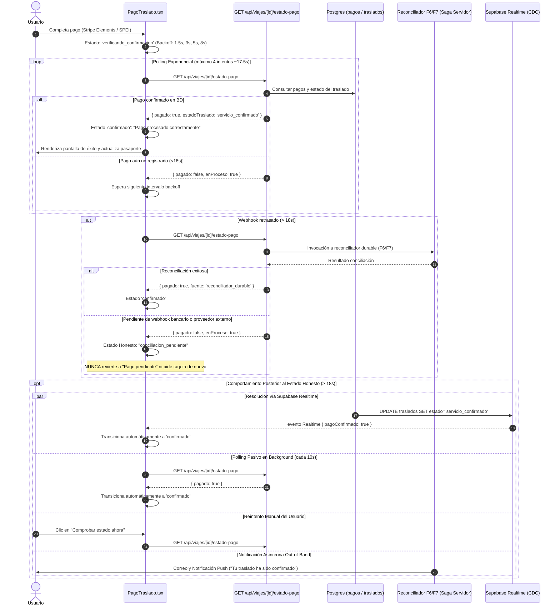

# Contrato de Resolución de Estado de Pago (Flujo 10 - Acciones del Traslado)

## 1. Identificación y Objetivos
- **Ticket**: RUUM-USR-F10-001
- **Condición Bloqueante**: CB-1
- **Componente**: App Usuario — Flujo 10 Acciones del Traslado (`PagoTraslado.tsx`, `/api/viajes/[id]/estado-pago/route.ts`)
- **Problema previo**: Uso de temporizador ciego (`setTimeout(1500)`) tras el pago con tarjeta o transferencia. Si el webhook de Stripe/banco tardaba 2–5 segundos, la pantalla refrescaba antes de registrarse el pago, revirtiendo a "Pago pendiente" con formulario de tarjeta. Esto generaba pánico de cobro doble o pagos duplicados no intencionales.

---

## 2. Flujo de Resolución Verificada (Zero Blind Timeout)

---

## 3. Especificación del Endpoint y Rate Limit

- **Ruta**: `GET /api/viajes/[id]/estado-pago`
- **Autenticación**: Obligatoria vía cookie de sesión Supabase (`getUser()`). Retorna `401 Unauthorized` si no hay sesión.
- **Validación de Identificador**: `id` debe cumplir regex UUID RFC 4122. En caso inválido: `404 Not Found`.
- **Control de Acceso Anti-IDOR**:
  - Consulta `traslados` por `id`. Si no existe o `traslado.usuario_id !== authUser.id`: `404 Not Found` (fail-closed, no revela existencia).
- **Rate Limit de Polling**:
  - **Identificador**: `uid:${user.id}:pago:${id}`
  - **Ventana**: 60,000 ms (1 minuto)
  - **Tope Máximo**: **30 peticiones por minuto**.
  - **Consumo Estimado de Polling Normal**:
    - Polling inicial exponencial (1.5s, 3s, 5s, 8s): 4 peticiones en 18s.
    - Polling pasivo posterior (cada 10s): 4–6 peticiones en el minuto restante.
    - Reintentos manuales de usuario: 1–3 peticiones.
    - **Total consumo pico**: ~12 peticiones/minuto.
    - **Margen de seguridad**: 250% del consumo máximo esperado.
  - **Respuesta en caso de exceso**: `429 Too Many Requests` con headers `Retry-After: <segundos>` y `Cache-Control: no-store`.

---

## 4. Comportamiento Posterior al Estado Honesto (> 18s)

Para asegurar que el estado intermedio ("Pago en proceso de confirmación") **no sea percibido como un callejón sin salida (terminal percibido)**, se define el siguiente ciclo de vida:

1. **Resolución en Segundo Plano vía Realtime**:
   - El canal WebSocket de Supabase (`useTrasladoRealtime`) sigue escuchando cambios sobre la fila del traslado.
   - En el instante en que el webhook bancario impacta la base de datos o el cron de reconciliación actualiza el registro, `AppStateProvider` recibe el evento y muta `pagoConfirmado: true`.
   - `PagoTraslado.tsx` detecta el cambio reactivo y transiciona inmediatamente a la pantalla verde de `"Pago procesado correctamente"`.

2. **Polling Pasivo de Respaldo**:
   - Mientras el usuario mantenga abierta la pantalla, se activa un intervalo de consulta periódica pasiva cada **10 segundos**.
   - Si la conexión WebSocket de Realtime estuviera degradada por red móvil deficiente, el polling pasivo detecta la actualización y transiciona la interfaz.

3. **Reintento Manual sin Fricción**:
   - La interfaz provee el botón interactivo **"Comprobar estado ahora"**, el cual ejecuta una verificación inmediata contra el endpoint sin recargar la página completa.

4. **Notificaciones Asíncronas Out-of-Band**:
   - La pantalla muestra el aviso explicativo:
     > *"Te notificaremos por correo electrónico en cuanto la confirmación concluya. Puedes cerrar esta ventana con tranquilidad o comprobar el estado en tiempo real."*
   - Al consolidarse el pago en base de datos, el reconciliador durable despacha el correo de confirmación de servicio con folio y póliza GNP.

5. **Canal de Soporte Directo**:
   - Se incluye un enlace directo a `/soporte?motivo=pago_en_conciliacion&traslado=${trasladoId}` con contexto pre-cargado para resolver cualquier duda con el equipo de operaciones.

6. **Invariante Innegociable**:
   - **Bajo ninguna circunstancia** la interfaz revierte al formulario de tarjeta ni muestra "Pago pendiente" con monto a cobrar.

---

## 5. Matriz de Estados de la UI en Pago

| Estado del Hook / Polling | Visualización en UI | Botones Disponibles | Vuelve a pedir tarjeta |
| :--- | :--- | :--- | :--- |
| `esperando_pago` (sin pago) | Formulario de tarjeta / Cotización | Pagar Ahora / Cancelar | Sí (inicial) |
| `verificando_confirmacion` (<18s) | Spinner: "Confirmando pago con el banco..." | Deshabilitados | No |
| `confirmado` | Banner verde: "Pago procesado correctamente" | Actualizar estado ahora | No |
| `conciliacion_pendiente` (>18s) | Banner ámbar: "Pago en proceso de confirmación" | Comprobar estado ahora / Soporte | **NO (Estrictamente bloqueado)** |
| `error` (rechazo explícito banco) | Banner rojo con causa de declinación emitida por pasarela | Reintentar con otra tarjeta | Sí (explícito del banco) |
