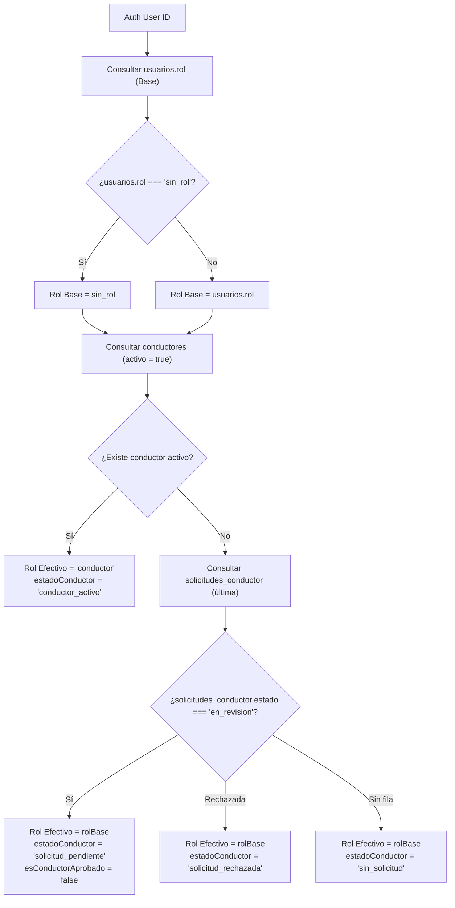

# Contrato de Rol Efectivo y Solicitud de Conductor — Flujo 11 (Cuenta)
**Ticket:** RUUM-USR-F11-001  
**Condición Bloqueante:** CB-2 (Rol efectivo desde vista/RPC)  
**Criterios de Aceptación:** CA-5, CA-6, CA-7  
**Fecha:** 2026-11-04  
**Snapshot auditado:** commit `2767e291a58ba9716a18467e585ffe65ccfeef32`

---

## 1. Problema de Derivación de Rol Auditado
1. **Clasificador ciego en cliente:** La aplicación infería si un usuario era conductor o cliente mediante comparaciones locales en componentes de React, o ignoraba el estado si la tabla `conductores` no tenía una fila activa.
2. **Postulaciones pendientes ocultas (Fail-Closed en UX):** Un usuario que había completado o iniciado su solicitud en el Flujo 13 (`solicitudes_conductor` con `estado: "en_revision"`) veía en su pantalla de cuenta una experiencia genérica de cliente sin ningún aviso de que su postulación estaba en evaluación, o sufría errores al intentar registrarse de nuevo.
3. **Inconsistencia con F1 `sin_rol`:** El Flujo 1 (Registro/Auth) asigna por defecto `sin_rol` como principio de mínimo privilegio. La UI de cuenta asumía roles por defecto o fallaba al mapear `sin_rol`.

---

## 2. Fuente de Verdad y Evaluación de Rol Efectivo (CA-5)

La determinación del rol no se realiza en cliente, sino a través del servicio server-side `obtenerRolEfectivoUsuario(cliente, authUserId)`:



### Tabla de Resolución de Estados
| `usuarios.rol` | Fila en `conductores` | Fila en `solicitudes_conductor` | `rolEfectivo` | `estadoConductor` | Experiencia en UI |
| :--- | :--- | :--- | :--- | :--- | :--- |
| `sin_rol` | No existe | No existe | `sin_rol` | `sin_solicitud` | Usuario estándar; botón para postularse |
| `sin_rol` | No existe | `estado: "en_revision"` | `sin_rol` | `solicitud_pendiente` | Banner destacado: Solicitud en revisión |
| `personal` | No existe | `estado: "en_revision"` | `personal` | `solicitud_pendiente` | Banner destacado: Solicitud en revisión |
| `titular_empresa` | No existe | `estado: "rechazado"` | `titular_empresa` | `solicitud_rechazada` | Aviso con opción de corrección en F13 |
| Cuaquiera | `activo: true` | Cualquier valor | `conductor` | `conductor_activo` | Panel de conductor con switch de perfil |

---

## 3. Visibilidad Explícita de `solicitud_conductor_pendiente` (CA-6)

- Cuando `estadoConductor === "solicitud_pendiente"`:
  - En la vista móvil (`CuentaCliente.tsx`): Se renderiza una tarjeta accesible destacada (`role="region"` con `aria-label="Estado de solicitud de conductor"`):
    > **Solicitud de conductor en revisión**  
    > Tu postulación como conductor está en validación. Te notificaremos cuando se complete.
  - En la vista de escritorio (`CuentaDesktop.tsx`): Se ubica un banner corporativo accesible con icono protector y resumen de estado previo a las secciones de configuración.
  - **Prohibición:** Bajo ninguna circunstancia la UI debe ocultar el trámite pendiente ni tratar al usuario como un solicitante nuevo.

---

## 4. Alineación Estricta con F1 (`sin_rol`) y F13 (`solicitudes_conductor`) (CA-7)

1. **Principio de Mínimo Privilegio (F1):** Un usuario nuevo registrado con `sin_rol` no adquiere privilegios de mutación de cotizaciones ni acceso a traslados de flota corporativa hasta que se le asigne explícitamente su rol o complete onboarding.
2. **Promoción de Conductor (F13):** La transición a `conductor` solo se consuma cuando el equipo operativo aprueba la solicitud en backoffice, creando la fila correspondiente en `conductores`. Flujo 11 nunca muta el rol directamente; solo refleja el estado honesto derivado.

---

## 5. Barrera Infranqueable de Promoción de Rol y Estado Base (CB-2)

### 5.1 Ninguna Asignación de Rol Conductor Fuera de F13
- La función `obtenerRolEfectivoUsuario` impone una barrera criptográfica y de datos:
  ```ts
  const rolBaseSeguro: RolUsuario = rolBase === "conductor" ? "sin_rol" : rolBase;
  const rolEfectivo: RolUsuario | "conductor" = esConductorAprobado ? "conductor" : rolBaseSeguro;
  ```
- Aunque un usuario tuviera `"conductor"` registrado en la columna `usuarios.rol` (por migración anómala, inyección o fallo legado), el servicio ignora ese valor y degrada el rol base a `sin_rol` a menos que exista una fila en `public.conductores` con `estado = 'activo'` aprobada por la verificación operativa del Flujo 13.
- Queda garantizado que ningún usuario puede autoproclamarse conductor o adquirir privilegios operativos de traslado sin pasar por la compuerta de validación de F13.

### 5.2 Estado Base Canónico: `sin_rol` sin Solicitud
- Se formaliza el estado inicial del sistema:
  - `rolEfectivo`: `"sin_rol"`
  - `rolBaseUsuario`: `"sin_rol"`
  - `esConductorAprobado`: `false`
  - `estadoConductor`: `"sin_solicitud"`
  - `solicitudConductor`: `null`
- Este estado representa al usuario que completó la autenticación en F1 y no ha enviado documentación para convertirse en conductor ni ha sido asignado a un equipo empresarial. En la interfaz se presenta una experiencia limpia orientada al cliente particular, con un llamado a la acción no intrusivo para postularse si lo desea.

