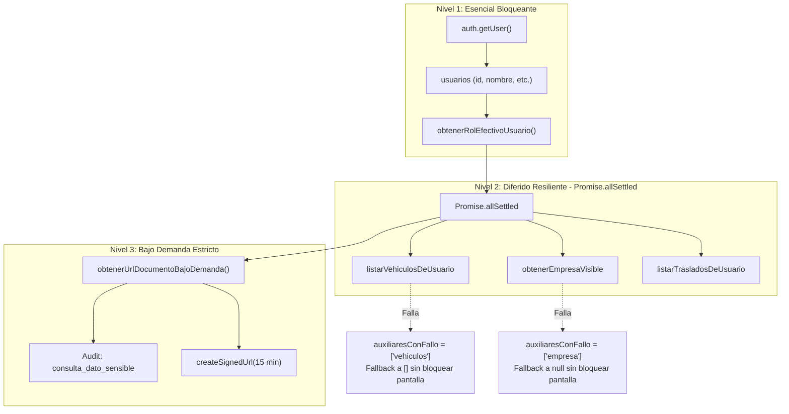

# Contrato de Sesión, Orden de Carga y Estados Honestos — Flujo 11 (Cuenta)
**Ticket:** RUUM-USR-F11-001  
**Condición Bloqueante:** CB-3 (Contrato de sesión, orden de carga y estados honestos)  
**Criterios de Aceptación:** CA-8, CA-9, CA-10  
**Fecha:** 2026-11-04  
**Snapshot auditado:** commit `2767e291a58ba9716a18467e585ffe65ccfeef32`

---

## 1. Problemas de Sesión y UX Engañosa Auditados
1. **Contrato de Sesión Ambiguo:** Llamadas a `supabase.auth.signOut()` sin especificar `{ scope }`, provocando ambigüedad entre revocar solo la sesión en el dispositivo actual o invalidar todas las sesiones en otros navegadores/móviles.
2. **Carga Frágil en Cascada (Todo o Nada):** `obtenerCuenta` utilizaba `Promise.all` para resolver vehículos, empresa e historial de traslados. Si el microservicio de vehículos o la consulta de empresa fallaba por un timeout transitorio, toda la pantalla de cuenta colapsaba en error, impidiendo incluso que el usuario viera su nombre o cerrara sesión.
3. **Presencia en Tiempo Real Falsa:** En `CuentaCliente.tsx` existía un punto verde estático (`bg-[#22c55e]`) superpuesto en el avatar del usuario, sugiriendo presencia online en tiempo real sin soporte de WebSockets, Supabase Realtime o Presence API.
4. **Badges de Verificación Engañosos:** `BadgeVerificacion` renderizaba un fondo verde con checkmark de aprobación aún cuando el estado era `"rechazado"` o `"pendiente"`, y además defaulteaba estados nulos a `"verificado"`.

---

## 2. Contrato de Revocación de Sesión en Backend (CA-10 / CB-3)

La revocación de sesión no es una simple limpieza de almacenamiento local del navegador; es una operación criptográfica ejecutada en el servidor de autenticación (GoTrue / Supabase Auth).

### 2.1 Tabla de Comportamiento por Scope
| Acción de UI | Scope Enviado | Endpoint Backend Invocado | Efecto en Servidor (GoTrue / PostgreSQL) | Limpieza Local Adicional |
| :--- | :--- | :--- | :--- | :--- |
| **Cerrar sesión en este dispositivo** | `scope: "local"` | `POST /auth/v1/logout?scope=local` | Revoca en el servidor el refresh token específico de esta sesión en `auth.refresh_tokens`. Las demás sesiones continúan vigentes. | Purga `localStorage` de borradores y cachés. Redirige a `/login`. |
| **Cerrar sesión en todos los dispositivos** | `scope: "global"` | `POST /auth/v1/logout?scope=global` | Invalida masivamente todos los refresh tokens del usuario en `auth.refresh_tokens`. Todas las sesiones remotas son expulsadas. | Purga `localStorage`. Redirige a `/login`. |
| **Cerrar otras sesiones** | `scope: "others"` | `POST /auth/v1/logout?scope=others` | Invalida todos los refresh tokens excepto el que autenticó la petición HTTP actual. | Mantiene sesión local activa. Notifica al usuario en el diálogo. |

### 2.2 Garantías de Revocación Backend
1. **Invocación HTTP Obligatoria**:
   - `crearClienteNavegador().auth.signOut({ scope })` envía una petición HTTP formal con header `Authorization: Bearer <session_access_token>`.
   - Si la llamada al backend falla (por error 500 o corte de red), se captura el error, se emite log de error estructurado (`logStructuredError("cuenta", "cerrar_sesion_fallido", err)`) y se alerta al usuario sin dejarlo en un estado falso de desautenticación.
2. **Rechazo Categórico de Tokens Revocados**:
   - Al revocarse un refresh token en backend, cualquier solicitud posterior a `/auth/v1/token?grant_type=refresh_token` es rechazada con `HTTP 400 Bad Request`:
     ```json
     {
       "error": "invalid_grant",
       "error_description": "Invalid Refresh Token: Refresh Token Not Found"
     }
     ```
   - Esto impide que tokens robados o residuales de un dispositivo desautenticado puedan emitir nuevos access tokens JWT.

---

## 3. Arquitectura de Carga en Tres Niveles (CA-8, CA-9)



### Resiliencia de Fallos Auxiliares
- Si falla cualquiera de las consultas del Nivel 2 (vehículos, empresa o traslados):
  - La pantalla **no colapsa ni muestra pantalla en blanco**.
  - Los datos esenciales del titular permanecen visibles y funcionales.
  - Se registra el aviso estructurado en logs (`[cuenta] servicios_auxiliares_con_fallo_diferido`).
  - La propiedad `datosAuxiliaresCargados` se establece en `false` y `auxiliaresConFallo` lista los servicios afectados.

---

## 4. Honestidad Visual y Estados Textuales (CA-10)

### 4.1 Eliminación del Indicador Falso de Presencia
- Se eliminó completamente el punto verde absoluto sobre el avatar (`span.rounded-full.bg-[#22c55e]`). No se simula presencia en tiempo real sin infraestructura de Presence.

### 4.2 Matriz de Badges de Verificación
| Estado | Color Fondo / Texto | Icono | Texto Visible | Fallback |
| :--- | :--- | :--- | :--- | :--- |
| `verificado` | Verde (`#eaf8f0` / `#10b981`) | Checkmark | "Verificado" | N/A |
| `en_revision` | Azul (`#eff6ff` / `#2563eb`) | Reloj / Espera | "En revisión" | N/A |
| `rechazado` | Rojo (`#fef2f2` / `#dc2626`) | Cruz / Alerta | "Rechazado" | N/A |
| `pendiente` | Gris Pizarra (`#f1f5f9` / `#475569`) | Círculo informativo | "Pendiente" | Estado por defecto si es nulo o indefinido |

*Regla crítica:* Ningún estado no verificado o ausente vuelve a evaluarse como "Verificado" por omisión.
