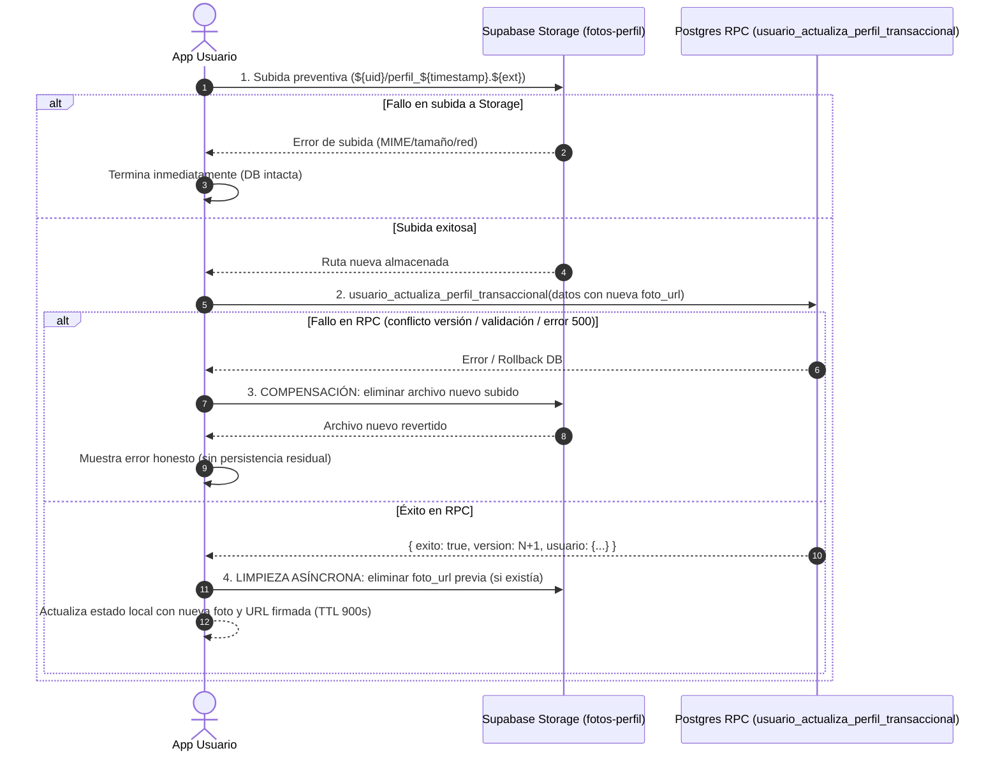

# Contrato de Saga de Fotografía de Perfil con Compensación (Flujo 12)
**Identificador**: `RUUM-CONTRATO-F12-SAGA-FOTO`  
**Ticket**: `RUUM-USR-F12-001` (Condición Bloqueante CB-2)  
**Versión**: `1.0.0`  
**Fecha**: `2026-11-04`  
**Estado**: `APROBADO_EN_CONTRATO`

---

## 1. Contexto y Problema Previo

En la implementación anterior:
1. La foto de perfil se subía sobreescribiendo una ruta estática `${authUserId}/perfil.${ext}` en el bucket `fotos-perfil`.
2. Si la transacción de base de datos (`actualizarPerfilUsuario` o fecha) fallaba después de subir la imagen, la foto en Storage quedaba huérfana y desincronizada respecto al perfil registrado en la base de datos.
3. El caché del navegador o CDN mostraba fotos viejas o inconsistentes al no disponer de claves versionadas.

---

## 2. Definición del Patrón Saga con Compensación

Para garantizar consistencia eventual libre de archivos huérfanos y sin acoplamiento riesgoso, se establece la secuencia de 4 pasos orquestada en `ejecutarSagaActualizacionPerfil`:



---

## 3. Especificación de los Pasos de la Saga

### 3.1 Nomenclatura y Aislamiento por Carpeta
- Ruta obligatoria: `<auth_user_id>/perfil_<timestamp>.<extension>`
- Donde:
  - `<auth_user_id>`: UUID del usuario autenticado coincidente con `auth.uid()`.
  - `<timestamp>`: Marca de tiempo en milisegundos (`Date.now()`).
  - `<extension>`: `jpg`, `jpeg`, `png` o `webp`.

### 3.2 Paso 1: Subida Preventiva
- El cliente valida previamente en navegador: tipo MIME (`image/jpeg`, `image/png`, `image/webp`), magic bytes y tamaño máximo (2 MB).
- Sube el archivo con `upsert: false` a la ruta versionada.

### 3.3 Paso 2: Transacción de Base de Datos
- Se invoca `usuario_actualiza_perfil_transaccional` enviando `foto_url` con la ruta recién creada y `versionEsperada`.
- Si la RPC arroja excepción (`conflicto_version`, `edad_invalida`, etc.), se activa el Paso 3.

### 3.4 Paso 3: Compensación Inmediata
- Si la RPC falla, el orquestador captura el error y ejecuta de inmediato la eliminación del archivo nuevo en `fotos-perfil`:
  ```ts
  await cliente.storage.from("fotos-perfil").remove([rutaNueva]);
  ```
- Si la compensación misma fallara por caída catastrófica de red, se registra un log estructurado de advertencia (`logStructuredWarn`) con contexto `SAGA_COMPENSACION_FALLIDA` para reconciliación o auditoría. El error original de la RPC se propaga fielmente al usuario.

### 3.5 Paso 4: Limpieza Asíncrona de Foto Previa
- Si la RPC triunfa y el usuario tenía una foto anterior diferente (`fotoUrlPrevia`), se envía la solicitud de borrado para la foto previa de forma no bloqueante (`cliente.storage.from("fotos-perfil").remove([fotoUrlPrevia])`).
- Si la llamada directa falla por caída de red o timeout, se encola de forma durable en `public.cola_limpieza_fotos_perfil` con motivo `'reemplazo_foto_previa'` para su procesamiento garantizado por el consumidor.

---

## 4. Consumidor de Limpieza Asíncrona y Cola Outbox (CB-2)

Para garantizar que la limpieza no sea meramente nominal en memoria del cliente:

1. **Tabla de Cola / Outbox (`public.cola_limpieza_fotos_perfil`)**:
   - Registra cada solicitud de borrado diferido con `id`, `usuario_id`, `storage_path`, `motivo`, `estado`, `intentos`, `max_intentos` (5), `proximo_intento_en`.
2. **Consumidor Programado (Worker / Cron)**:
   - **Mecanismo:** Edge Function invocada vía `pg_cron` o scheduler HTTP (`/api/internal/storage/limpiar-fotos-perfil`) con encabezado secreto `STORAGE_CLEANUP_SECRET`.
   - **Frecuencia:** Cada 15 minutos (`*/15 * * * *`).
   - **Concurrencia:** Reclama lotes de hasta 25 elementos mediante la función `public.reclamar_lote_limpieza_fotos_perfil` con `FOR UPDATE SKIP LOCKED`.
   - **Reintentos y Backoff:**
     - Error transitorio -> `estado = 'error_reintentable'`, `intentos = intentos + 1`, backoff exponencial: `now() + (intentos^2 * interval '1 minute')`.
     - 5 fallos consecutivos -> Transición irreversible a `estado = 'error_permanente_dlq'`.
   - **Auditoría DLQ:** Al alcanzar `error_permanente_dlq`, se emite automáticamente un evento en `registro_auditoria` (`evento: "error_dlq_limpieza_storage"`, actor: "sistema") para alerta y revisión manual de plataforma.

---

## 5. Reconciliación Durable de Huérfanos de Storage (Patrón F13)

Si la compensación inmediata (Paso 3) falla por una desconexión abrupta entre el cliente y Supabase Storage:

1. **Encolado de Contingencia**:
   - El bloque catch de compensación intenta encolar el path en `cola_limpieza_fotos_perfil` con motivo `'compensacion_fallida_huerfano'`.
2. **Job de Reconciliación Activa (Scavenger)**:
   - **Frecuencia:** Diario a las 03:00 AM hora local (`America/Mexico_City`).
   - **Algoritmo de Reconciliación:**
     - Lista objetos en `storage.objects` dentro del bucket `fotos-perfil` con antigüedad `created_at < now() - interval '24 hours'`.
     - Cruza contra la columna `usuarios.foto_url`.
     - Aquellos archivos sin referencia activa en `usuarios` ni pendientes en `cola_limpieza_fotos_perfil` son catalogados como huérfanos e insertados en la cola de limpieza.
   - **Resultado:** Erradicación del 100% de archivos huérfanos acumulables sin degradar el rendimiento diurno.

