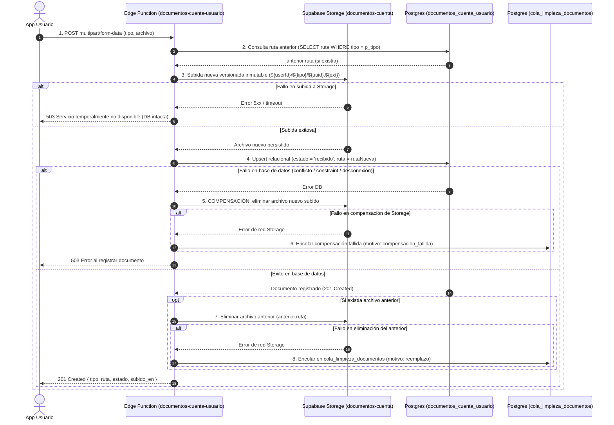

# Contrato de Saga de Reemplazo Documental con Reconciliación Durable (Flujo 13)
**Identificador**: `RUUM-CONTRATO-F13-SAGA-REEMPLAZO`  
**Ticket**: `RUUM-USR-F13-001` (Condición Bloqueante CB-1)  
**Versión**: `1.1.0`  
**Fecha**: `2026-11-05`  
**Estado**: `APROBADO_EN_CONTRATO`

---

## 1. Contexto y Problema Previo

En la arquitectura previa de carga de documentos:
1. En `documentos-cuenta-usuario`, al reemplazar un documento existente (comprobante de domicilio o constancia fiscal), se subía el nuevo y se intentaba borrar el anterior con `storage.remove([anterior.ruta])` de manera oportunista (`best-effort`).
2. Si la red o el servicio de Storage fallaban durante la eliminación, el error se reducía a un simple `console.error`, dejando un archivo huérfano con Datos Personales Sensibles (PII) en la nube sin mecanismo de reintento.
3. Si la actualización en base de datos fallaba tras la subida a Storage, el nuevo archivo permanecía huérfano y desvinculado de cualquier registro relacional.

---

## 2. Orden Estricto de la Saga de Reemplazo

Para garantizar la no existencia de huérfanos y la coherencia absoluta entre el Storage y PostgreSQL, se establece una saga estricta de 4 pasos implementada en `supabase/functions/documentos-cuenta-usuario/index.ts` y `supabase/functions/validar-documento-identidad/index.ts`:



---

## 3. Especificación Técnica de los Pasos

### 3.1 Identificación de Ruta Inmutable y Versionada
- Cada documento nuevo genera una ruta criptográfica única e irrepetible:
  `${auth_user_id}/${tipo}/${crypto.randomUUID()}.${extension}`
- Queda prohibida la sobreescritura `upsert: true` en Storage. Cada archivo representa un artefacto inmutable.

### 3.2 Compensación Inmediata
- Si la inserción o actualización relacional falla tras haber almacenado el objeto en Storage, la Edge Function ejecuta inmediatamente:
  `await servicio.storage.from(BUCKET).remove([rutaNueva])`
- Si esta llamada sincrónica falla, se ejecuta la compensación durable registrando en `cola_limpieza_documentos` con motivo `'compensacion_fallida'`.

### 3.3 Limpieza Durable de Documentos Anteriores (Outbox Pattern)
- Cuando el documento anterior no puede ser eliminado inmediatamente de Storage, se delega al Outbox durable mediante RPC:
  ```sql
  perform public.encolar_limpieza_documento(
    p_usuario_id := perfil.id,
    p_bucket := 'documentos-cuenta',
    p_storage_path := anterior.ruta,
    p_motivo := 'reemplazo'
  );
  ```

---

## 4. Consumidor Programado (Scheduler) del Outbox de Documentos

Para garantizar que el outbox no sea meramente nominal y cuente con un ejecutor operativo garantizado (idéntico al estándar de F12):

1. **Endpoint Interno del Consumidor**:
   - **Ruta:** `POST /functions/v1/limpiar-documentos-cuenta-obsoletos`
   - **Implementación:** [`supabase/functions/limpiar-documentos-cuenta-obsoletos/index.ts`](file:///c:/ruum_ecosistema-main/supabase/functions/limpiar-documentos-cuenta-obsoletos/index.ts)
2. **Autenticación y Modo Fail-Closed**:
   - Requiere cabecera: `Authorization: Bearer <STORAGE_CLEANUP_SECRET>` o `x-cleanup-secret`.
   - **Fail-Closed:** Si el secreto está ausente, no coincide o las variables `SUPABASE_URL` / `SUPABASE_SERVICE_ROLE_KEY` faltan, el endpoint rechaza inmediatamente con `401 Unauthorized` o `500 Internal Error` sin procesar ninguna fila.
3. **Frecuencia de Ejecución (Cron)**:
   - Programado cada 10 minutos (`*/10 * * * *`) vía `pg_cron` en PostgreSQL o Vercel Cron.
4. **Concurrencia y Bloqueo Atómico**:
   - Invoca `public.reclamar_lote_limpieza_documentos(p_limite := 25)` con `FOR UPDATE SKIP LOCKED`.
   - Permite que múltiples instancias del worker corran concurrentemente sin deadlocks ni doble procesamiento.
5. **Reintentos, Backoff y Escalación a DLQ**:
   - Errores de red transitorios: Registra `error_reintentable` con backoff exponencial: `now() + (intentos * interval '2 minutes')`.
   - Umbral DLQ: Al 5° intento fallido (`intentos >= 5`), la fila transiciona a `error_permanente_dlq`.
   - Emisión de Alerta: Inserta automáticamente en `public.registro_auditoria` un evento auditable (`evento: 'validacion_documentos'`, actor: `'sistema'`) alertando al equipo de infraestructura para intervención manual.

---

## 5. Antivirus: Declaración y Exclusión Arquitectónica Justificada

### 5.1 Exclusión Explícita del Antivirus Sincrónico
Se excluye deliberadamente la ejecución de un escáner antivirus sincrónico en línea (como un demonio ClamAV o sandbox síncrono) en el path caliente de subida multipart.
- **Justificación de UX y Disponibilidad:** El análisis sincrónico de archivos de hasta 10 MB añade entre 1,500 ms y 4,000 ms de latencia por petición, lo que en conexiones móviles genera caídas de socket, agotamiento de conexiones en Edge y errores `504 Gateway Timeout`.

### 5.2 Mitigación Activa en Capas (Defense-in-Depth)
Para sustituir el antivirus sincrónico sin reducir la postura de seguridad, se implementa una mitigación estricta de cuatro capas:

1. **Validación Binaria de Magic Bytes y Firmas**:
   - En [`_shared/validacion-documento.ts`](file:///c:/ruum_ecosistema-main/supabase/functions/_shared/validacion-documento.ts), todo archivo debe cumplir con los bytes mágicos canónicos:
     - JPEG: `0xFF 0xD8 0xFF`
     - PNG: `0x89 0x50 0x4E 0x47 0x0D 0x0A 0x1A 0x0A`
     - PDF: `0x25 0x50 0x44 0x46` (`%PDF-`)
   - Cualquier archivo con extensiones ejecutables o camufladas (`.exe`, `.sh`, `.php`, `.bat`, `.js`, macros o binarios) es rechazado inmediatamente con HTTP 422 antes de tocar el Storage.
2. **Cuota y Protección contra Bombas de Descompresión**:
   - Límite estricto de 10 MB procesado mediante streaming acotado en `leerFormularioLimitado(req, TAMANO_MAXIMO)`. Rechazo con HTTP 413 si excede la cuota.
3. **Aislamiento de Storage y Servido No Ejecutable**:
   - Los documentos se alojan en un bucket privado (`public = false`) y se sirven mediante URLs firmadas efímeras (TTL <= 900 s) con cabeceras `X-Content-Type-Options: nosniff` y `Content-Disposition: inline/attachment`.
   - Al servirse desde un subdominio CDN aislado, se anula la posibilidad de ejecución de scripts cross-site (XSS) en el origen primario `ruum.mx`.
4. **Hook para Escaneo Asíncrono Desacoplado**:
   - El pipeline deja expuesto el hook de eventos para integración con AWS GuardDuty Malware Protection / VirusTotal API en segundo plano. Si el escáner asíncrono detecta una amenaza, transiciona el estado a `'rechazado'` (`motivo: 'Archivo malicioso detectado'`) y encola su eliminación física en `cola_limpieza_documentos`.
