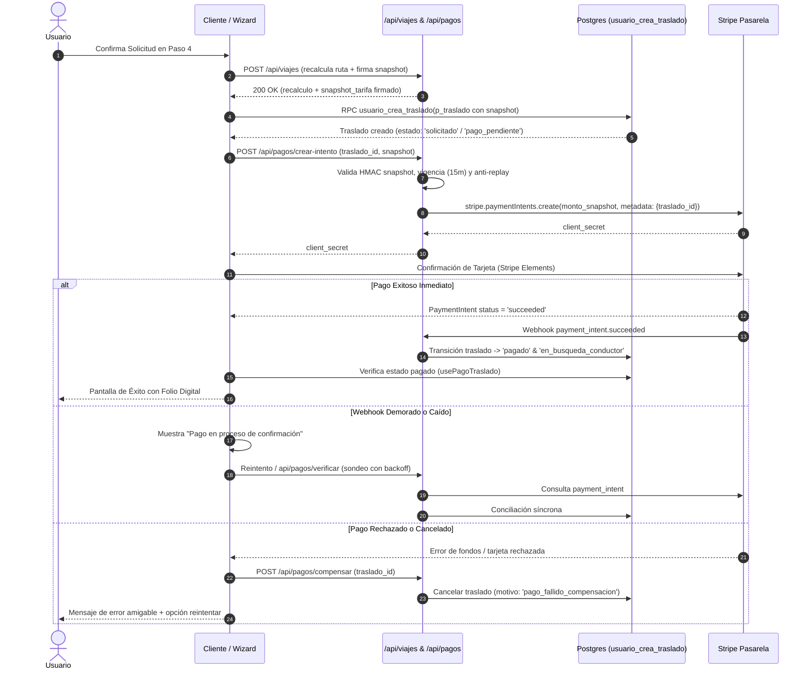

# Contrato de la Saga Transaccional de Pago — Solicitud Individual (F6)
**Ticket**: RUUM-USR-F6-001  
**Condición Bloqueante**: CB-2  
**Criterios de Aceptación**: CA-9, CA-10  
**Fecha de Publicación**: 2026-11-04  

---

## 1. Visión General de la Saga

La creación y cobro de un traslado individual involucra dos fuentes de estado distribuidas:
1. **Base de Datos PostgreSQL (Supabase)**: Persistencia del registro del traslado, vehículo, ruta y snapshot tarifario firmado.
2. **Pasarela Externa (Stripe)**: Autorización, captura y liquidación de fondos mediante `PaymentIntent`.

Para prevenir traslados impagos (estados huérfanos en BD sin fondos) o cobros sin servicio (cargos en tarjeta sin traslado asociado), se define la siguiente **Saga Coreográfica con Compensación y Reconciliación Durable**.

---

## 2. Diagrama de Estados y Fases de la Saga

---

## 3. Matriz de Estados de la Saga

| Estado de Negocio | Estado en DB (`traslados.estado`) | Estado en Stripe (`payment_intent.status`) | Acción del Sistema / Resiliencia |
| :--- | :--- | :--- | :--- |
| **Inicial** | `solicitado` / `pago_pendiente` | No existe | Esperando creación del `PaymentIntent`. |
| **En Cobro** | `pago_pendiente` | `requires_payment_method` o `processing` | Formulario Stripe activo; timeout de 15 min alineado al TTL del snapshot. |
| **En Reconciliación** | `pago_pendiente` | `succeeded` | Hook `usePagoTraslado` muestra badge "Pago en proceso de confirmación" mientras el webhook procesa. |
| **Completado** | `pagado` / `en_busqueda_conductor` | `succeeded` | Folio digital emitido; habilitado para asignación de chofer. |
| **Compensado** | `cancelado_automatico` | `requires_payment_method` (fallido) / `canceled` | Ejecutada función de compensación por fallo de pago o abandono. |

---

## 4. Reglas Críticas de Resiliencia y Compensación

### 4.1 Declaración Formal del Reconciliador y Compensador de Saga (Bloque B / B1)
La ejecución de la compensación y reconciliación durable de la saga de F6 está asignada y formalmente contratada al componente:

| Dimensión | Especificación Canónica |
| :--- | :--- |
| **Componente de Base de Datos** | Función RPC `public.reconciliar_saga_traslados_individuales(p_limite integer default 50)` ([migración 20261104000005](file:///c:/ruum_ecosistema-main/supabase/migrations/20261104000005_flujo6_tarifa_snapshot_rescate_mecanico.sql)). |
| **Consumidor API / Endpoint** | `GET /api/internal/viajes/reconcile` ([route.ts](file:///c:/ruum_ecosistema-main/apps/app-usuario/src/app/api/internal/viajes/reconcile/route.ts)) protegido mediante `VIAJES_RECONCILIADOR_SECRET`. |
| **Dueño Operativo** | Equipo de Operaciones & Pasarela de Pagos RUUM (Tech Lead Backend & Finanzas). |
| **Frecuencia de Ejecución** | Cada 5 minutos (vía Vercel Cron o pg_cron `ruum-reconciliar-saga-f6`). |
| **Tamaño de Lote (Batching)** | 50 traslados por ejecución (ajustable de 1 a 200). |
| **Mecanismo de Concurrencia** | `FOR UPDATE SKIP LOCKED` sobre filas elegibles en `public.traslados` con `estado = 'cotizacion_generada'` y antigüedad $> 15\text{ minutos}$. Evita contención con workers paralelos o con la UI. |
| **Contador de Fallos y DLQ** | Contador estructurado `v_errores`. Las excepciones individuales quedan aisladas en bloque `BEGIN ... EXCEPTION` y se registran de forma auditable en `public.registro_auditoria` con evento `error_reconciliacion_saga_f6`, sin abortar el procesamiento del lote. |

### 4.2 Lógica de Compensación y Reconciliación en Lote
Para cada traslado reclamado con bloqueo `SKIP LOCKED`:
1. **Reconciliación de Pago Confirmado**: Si en `public.pagos` existe un registro en estado aprobado (`completado`, `aprobado`, `succeeded`), el traslado se transiciona a `servicio_confirmado` registrando en auditoría el evento `reconciliacion_pago_exitoso_traslado`.
2. **Compensación por Abandono o Rechazo**: Si no existe pago o el pago terminó en fallo tras agotar la vigencia de 15 min, el traslado se transiciona a `servicio_cancelado` registrando en auditoría el evento `compensacion_saga_pago_fallido` con motivo `pago_fallido_compensacion`.

### 4.3 Reconciliación Durable ante Caídas de Webhook (CB-2 / CA-10)
- **Cliente**: El hook [usePagoTraslado.ts](file:///c:/ruum_ecosistema-main/apps/app-usuario/src/app/viajes/nuevo/hooks/usePagoTraslado.ts) implementa el estado intermedio `pagoEnProcesoConfirmacion = true`. No bloquea la pantalla con un error falso; permite al usuario reintentar la verificación manualmente o consultar su pasaporte digital sin trabar la navegación.
- **Servidor / Worker**: Tarea periódica de reconciliación que consulta los `PaymentIntents` en estado `processing` o `succeeded` que no tengan un pago reflejado en la tabla `pagos` de Supabase tras 5 minutos, reconciliando de forma durable e idempotente.

### 4.4 Idempotencia Estricta
Para evitar doble cargo:
- Toda llamada a Stripe utiliza la clave de idempotencia `idempotencyKey = "pi-traslado-" + trasladoId`.
- El webhook de Stripe valida la firma HMAC del webhook secret y procesa el evento en la tabla `eventos_stripe_procesados` con clave primaria `event_id`.

---

## 5. Higiene de Interfaz y Expectativas (CA-7 / T8)

En cumplimiento estricto con el alcance del MVP:
- El componente [PasoPago.tsx](file:///c:/ruum_ecosistema-main/apps/app-usuario/src/app/viajes/nuevo/components/PasoPago.tsx) solo mantiene habilitada la pestaña **Tarjeta**.
- Las opciones **OXXO** y **Google Pay** se muestran deshabilitadas (`disabled`, `aria-disabled="true"`, cursor no permitido) acompañadas de un badge explícito **"Próximamente"**.
- Esto previene falsas expectativas, frustración de usuario y solicitudes fallidas.
